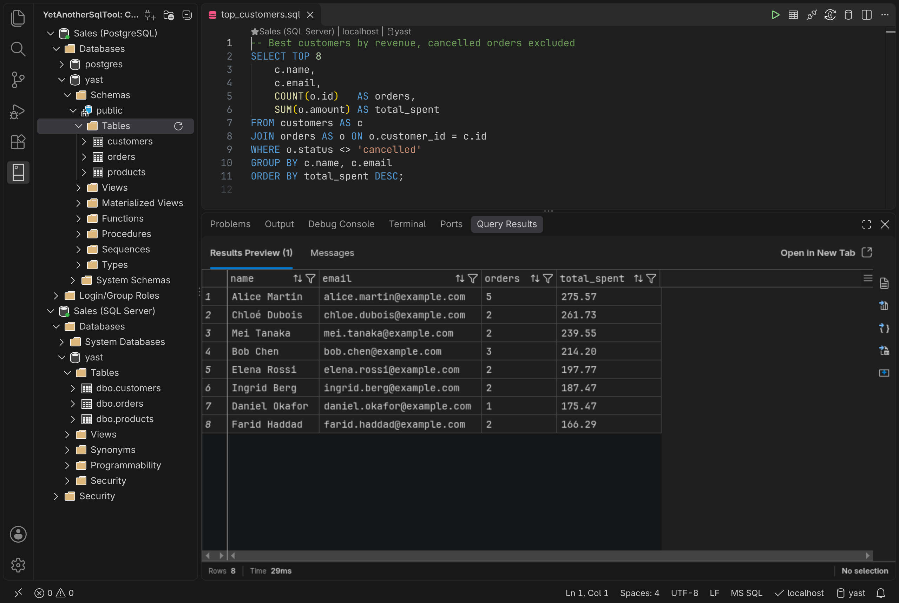
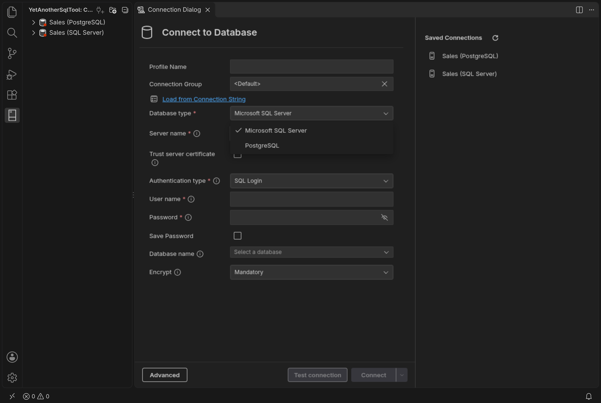
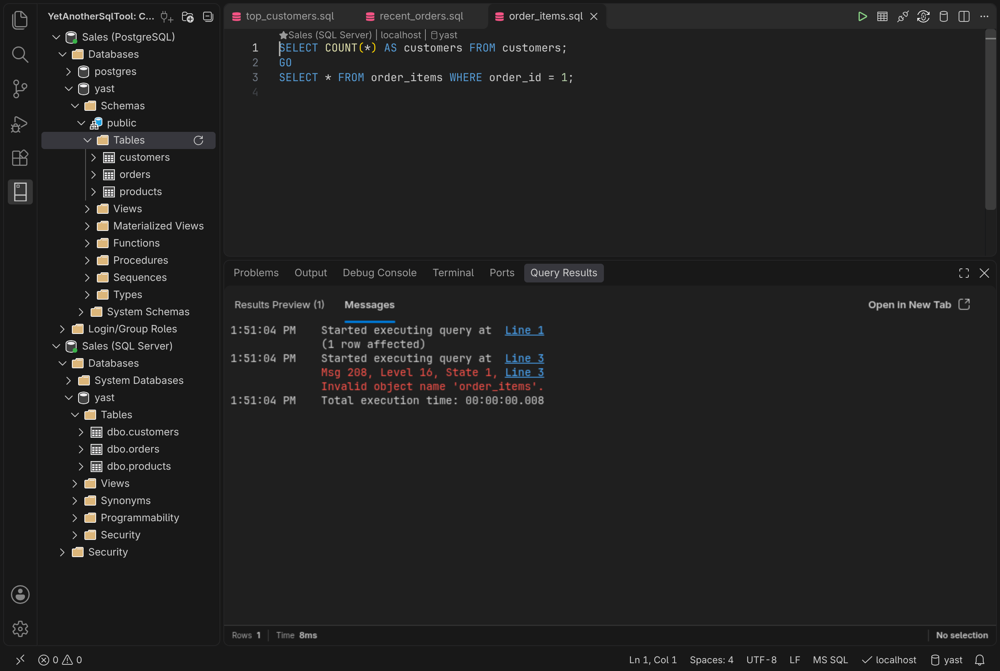
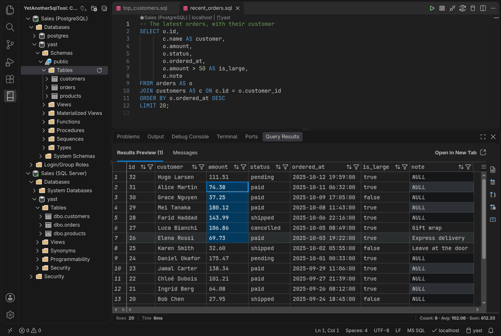
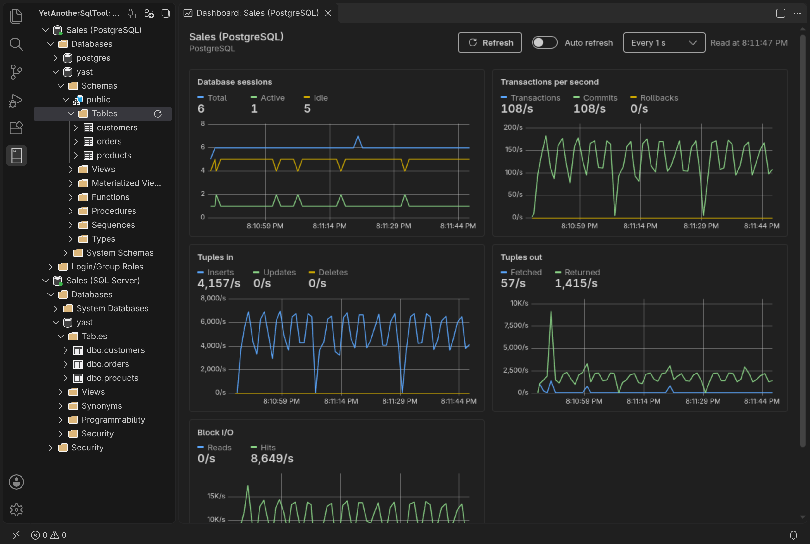

# YetAnotherSqlTool

A multi-database SQL client for Visual Studio Code, with a user experience inspired by Microsoft's SQL Server extension (`vscode-mssql`). It supports **SQL Server** and **PostgreSQL** today; **SQLite** and **MySQL / MariaDB** are planned.

> Not affiliated with or endorsed by Microsoft.

## Features

- **Object Explorer**: browse servers, databases and their objects in a tree, with connection groups, context menus, a "New Query" action on any connection and "Select Top 1000" on tables and views.
- **Connection dialog**: a form generated for each database engine, saved and recent connections, connection groups, and connection strings. Passwords are kept in VS Code's `SecretStorage`.

  
- **Import from the SQL Server extension**: the command **Import Connections from SQL Server Extension** (also offered in the Connections view while it has no connection) copies the connections and groups saved by Microsoft's SQL Server extension (`mssql.connections` and `mssql.connectionGroups` of your user settings, read only). Pick the connections to import, already present ones are unchecked, the group tree and names are kept and a second run adds nothing twice. Passwords cannot be imported (the SQL Server extension keeps them where only it can read them): they are asked at the first connection and saved then if "Save Password" was on. Whatever could not be carried over, such as unsupported options, unsupported authentication types, or Windows Authentication, which works differently in YAST, is listed per connection in the "YetAnotherSqlTool" output channel.
- **Filtered connections**: give a connection a database filter such as `*-dev-*` and it only shows the databases whose name matches, in the Object Explorer and in the editor's list of databases. Create several connections to the same server, one per environment. `*` and `?` are wildcards, `;` separates several patterns and a pattern starting with `!` hides the databases it matches.
- **Connection colors**: give a connection a color (red for production, green for development...) and every SQL editor using it shows that color, as a bar at the left of the editor and in the status bar, so you always see where a script is about to run.
- **One connection per editor**: every SQL editor owns its own connection, shown in the status bar and as a CodeLens at the top of the script. Connect, disconnect, change connection and change database from the editor.
- **Query execution**: several batches and result sets per script, rows streamed into the results grid as they arrive, a Messages tab with a link to the line in error, a plain-text view, and cancellation of a running query. Run the whole script, the selection, or just the statement under the cursor.

  
- **Autocompletion**: suggestions from the catalog of the connected database (schemas, tables, views, columns with their type, aliases, procedures, functions, data types and keywords of the engine), according to where the cursor is in the statement. "Refresh IntelliSense Cache" reloads the catalog; `yast.intelliSense.*` settings turn it off.
- **Script generation**: right-click an object for **Script as Create / Drop / Alter / Execute** (SQL Server scripts are the ones SSMS and Microsoft's extension produce; PostgreSQL scripts follow `pg_dump`). Right-click a database for **Generate Scripts...**: its schema, its data as `INSERT` statements, or both, into a new editor or a `.sql` file.
- **Syntax highlighting of the connected engine**: a SQL editor is colored with the keywords, data types, functions and syntax of the database it is connected to (PostgreSQL `ILIKE`, `RETURNING`, `::type`, `$$ ... $$` bodies and `"quoted"` names; T-SQL `TOP`, `[name]`, `GO`). Turn it off with `yast.syntaxHighlighting.engineSpecific`.
- **Object information** as in SSMS: select an object name and press `Alt+F1` to get its general information, columns, identity, indexes, constraints and the foreign keys and views that reference it; with nothing selected, the objects of the current database. SQL Server runs `sp_help`; PostgreSQL gets the equivalent grids from its catalog, for tables, views, functions and procedures (parameters of every overload), types and sequences.
- **Server dashboard**: right-click a connected server in the Object Explorer and choose **Dashboard** for live charts of what it is doing: sessions, transactions per second, rows or pages read and written, I/O. Refresh on demand, or turn on Auto refresh (every second to every minute). See [Server dashboard](#server-dashboard).
- **Large results**: a query returning millions of rows stays usable. Beyond a memory budget, rows are kept in a file instead of RAM; the grid pages anywhere in the result and "Save as" streams to the file.
- **Results grid**: selection summary, copy, sorting and filtering (up to a configurable row threshold), and many display settings.

  
- **Copy and save results**: copy as CSV, JSON, `IN (...)` clause or `INSERT INTO` statements; save as CSV, JSON, Excel or INSERT statements. SQL syntax is specific to each engine.
- **Microsoft Entra ID authentication** for Azure SQL and Azure Database for PostgreSQL: your VS Code Microsoft account, "Default" (machine identities such as Azure CLI or managed identity) and Service Principal.
- **Safer by default**: connections defined in an untrusted workspace are ignored, and Entra ID tokens are only sent to Azure servers (or servers you explicitly allow).

## Quick start

1. Open the **YetAnotherSqlTool** view in the Activity Bar and click **Add Connection**.
2. Choose the engine (SQL Server or PostgreSQL), fill in the form (or paste a connection string) and connect.
3. Right-click a connection in the Object Explorer and choose **New Query**, or open any `.sql` file and use **Connect**.
4. Run the query. Results appear in the **Query Results** panel.

Default keyboard shortcuts, active in SQL editors:

| Action | Windows / Linux | macOS |
|---|---|---|
| Execute Query (the selection, else the whole script) | `Ctrl+Shift+E` | `Cmd+Shift+E` |
| Execute Selection or Current Statement | `Ctrl+F5` | `Cmd+F5` |
| Cancel Query | `Alt+Pause` | `Alt+Pause` |
| Show Object Information (`sp_help`) | `Alt+F1` | `Alt+F1` |
| Show or hide the query results (also from the results view) | `Ctrl+R` | `Ctrl+R` |
| Connect | `Ctrl+Shift+C` | `Cmd+Shift+C` |
| Disconnect | `Ctrl+Shift+D` | `Cmd+Shift+D` |

Shortcuts inside the results views (switch tabs, copy, select, sort...) can be changed with the `yast.shortcuts` setting. Every command is also available from the Command Palette.

## Settings

All settings are under `yast.*`; search for "YetAnotherSqlTool" in the Settings editor. The most useful ones:

| Setting | Purpose |
|---|---|
| `yast.connections`, `yast.connectionGroups` | Connection profiles and groups (normally edited through the UI). |
| `yast.entraId.allowedServers` | Extra server names allowed to receive a Microsoft Entra ID token (see below). |
| `yast.defaultQueryResultsViewMode` | Show results as `Grid` (default) or `Text`. |
| `yast.openQueryResultsInTabByDefault` | Open results in an editor tab instead of the panel. |
| `yast.resultsGrid.*` | Column auto-sizing, grid lines, alternating rows, row padding, right-aligned numbers, in-memory sort/filter threshold. |
| `yast.resultsFontFamily`, `yast.resultsFontSize` | Font of the results grid. |
| `yast.saveAsCsv.*`, `yast.saveAsExcel.*` | Delimiter, headers, encoding and formatting of exported files. |
| `yast.copyIncludeHeaders`, `yast.copyRemoveNewLine` | Behaviour of copy in the results grid. |
| `yast.showBatchTime`, `yast.results.showBatchMessages` | Messages shown for each batch. |
| `yast.maxRecentConnections` | Number of recent connections remembered. |
| `yast.dashboard.refreshInterval` | Open the server dashboard with Auto refresh on, at this interval in seconds (0, the default: off). |

## Server dashboard

Right-click a connected server (or database connection) in the Object Explorer and choose **Dashboard**, or run **Dashboard** from the Command Palette and pick a connection. A panel opens with one chart per kind of activity, each with the last value of its series written above it:

- **PostgreSQL**, as pgAdmin's dashboard: database sessions (total, active, idle), transactions per second (total, commits, rollbacks), tuples in (inserts, updates, deletes) and out (fetched, returned), block I/O (reads, cache hits).
- **SQL Server**, from SSMS's Activity Monitor and the SQL Server performance counters: user sessions, batch requests and transactions per second, page reads and writes, file I/O, page life expectancy, buffer cache hit ratio.

Nothing refreshes on its own unless you ask: the dashboard reads the statistics when it opens and when you click **Refresh**. **Auto refresh** reads them every 1, 2, 5, 10 or 30 seconds or every minute; it is off by default, the interval you pick is remembered, and `yast.dashboard.refreshInterval` opens dashboards in auto mode. Auto refresh pauses while the panel is hidden. Rates (per second) come from the difference of two readings, so opening the dashboard and every Refresh take two readings a second apart. Each reading adds a point at the time it was taken, so a few manual refreshes draw an irregular but honest curve; a pause, a failed reading or a reconnection leaves a gap in the lines rather than an invented value. The panel keeps about the last 600 points of each chart (ten minutes at one reading a second), in memory only: closing the panel discards them. A failed reading or a lost connection shows an error above the charts, with **Reconnect**.

**Permissions.** Without them a login sees only part of the activity, and the dashboard says so in a banner above the charts instead of showing misleading numbers:

- PostgreSQL: the session counts need `pg_read_all_stats`, part of `pg_monitor` (`GRANT pg_monitor TO some_role;`); without it PostgreSQL hides what the sessions of other roles are, and the sessions chart stays empty. The transaction, tuple and block counters are readable by everyone.
- SQL Server: `VIEW SERVER STATE`, or `VIEW SERVER PERFORMANCE STATE` on SQL Server 2022 and later. Azure SQL Database: `VIEW DATABASE STATE` (or `VIEW DATABASE PERFORMANCE STATE`); there the sessions and file I/O are those of the database, not of the logical server.
- Azure Synapse dedicated and serverless SQL pools and Microsoft Fabric have no dashboard (their statistics views are not SQL Server's): opening one shows why.

The dashboard was tested on SQL Server 2022 and PostgreSQL 17 in containers. Azure SQL Database, Azure SQL Managed Instance, SQL Server before 2022, other PostgreSQL versions, Azure Database for PostgreSQL and Microsoft Entra ID sign-in on the dashboard's connection are expected to work but have not been tested.

**Cost on the server.** Each reading is one round trip of queries on in-memory statistics views (`pg_stat_activity` and `pg_stat_database`; SQL Server's dynamic management views): no table is read and no lock is taken. It takes well under a millisecond on PostgreSQL and a few milliseconds on SQL Server. The dashboard uses a connection of its own, named "YAST dashboard" (`application_name` / `Application Name`) so that a DBA can recognize it; it is closed with the panel. A reading still running when the next one is due is not doubled: that tick is skipped. Expensive views such as the query statistics of SSMS's Activity Monitor are not read.

## Authentication

- **SQL Server**: SQL login (user and password), Windows Authentication and Microsoft Entra ID.
- **Windows Authentication** (on-premises SQL Server) signs in with NTLM: choose "Windows Authentication" and enter the account as `DOMAIN\user` (or `user@domain`) with its password. It works from Linux and macOS too. Signing in with the current Windows session, and servers that only accept Kerberos, are not supported.
- **PostgreSQL**: user and password, and Microsoft Entra ID for Azure Database for PostgreSQL.
- **Microsoft Entra ID**:
  - *Microsoft account* mode uses the account you are signed in with in VS Code (the built-in Microsoft authentication provider). You pick the account and tenant, and a fresh token is requested for each physical connection.
  - *Default* mode uses the identities of the machine (environment, managed identity, Azure CLI...).
  - *Service Principal* mode uses a tenant, application (client) ID and secret.
- **Token audience protection**: a Microsoft Entra ID token is only sent to Azure servers (for example `*.database.windows.net` or `*.postgres.database.azure.com`). To use it with another name (a custom DNS name, or `localhost` through a tunnel), add it to `yast.entraId.allowedServers`; an entry starting with a dot, such as `.corp.example.com`, allows every name ending with it. A token sent to a server lets that server act as you on your Azure databases for about an hour, so only add servers you trust.
- **Workspace Trust**: connection profiles found in the settings of an untrusted workspace are ignored.

### Environment variables in connections

The text fields of a connection (server, database, user, password or client secret, tenant ID and the other options) can reference environment variables with `${env:NAME}`, as in VS Code's `launch.json`: for example `${env:SQL_PASSWORD}` as the password, or `${env:DB_HOST}` as the server. Names are made of letters, digits and `_`; they are case-sensitive, except on Windows.

- The variables are read from VS Code's own environment (the extension host's), only when a connection is opened. Their values are never written to settings or `SecretStorage`, and are not shown in the connection dialog, the Object Explorer, connection errors or connection strings: everything keeps the text as typed. After changing a variable, restart VS Code from a shell or session that has the new value.
- A variable that is not set makes the connection fail with a message naming it (`Environment variable SQL_PASSWORD is not set`), before anything is sent to the server. A variable set to an empty string is an empty value.
- A password holding a reference is not a secret: it is saved as typed in `yast.connections`, connecting does not ask for a password, and "Save Password" has nothing to store.
- `$${env:NAME}` is the literal text `${env:NAME}`. Other text containing `$` or braces is used as is.
- References in your user settings, or typed in the connection dialog, are read directly. A connection defined in the **workspace** settings (or a recent connection whose profile is not in your user settings) could send your variables to a server chosen by the repository: before reading them, a confirmation names the connection, its server as written and the variables. Allowing is remembered for that engine, server, port, authentication type, encryption settings (`encrypt`, `trustServerCertificate`, `hostNameInCertificate`, `sslmode`, `sslrootcert`) and those exact references; if one of them changes, the confirmation is shown again. The connection dialog does not list the databases of such a connection until you allow it with "Test Connection" or "Connect".

## Privacy

YetAnotherSqlTool collects **no telemetry**. The telemetry layer inherited from `vscode-mssql` is replaced by a stub that never sends anything, and the extension does not bundle any telemetry or analytics library. The extension only talks to:

- the database servers you connect to;
- Microsoft sign-in, through VS Code's built-in account provider or, for the "Default" and "Service Principal" Entra ID modes, the Azure Identity library. In "Default" mode that library looks for an identity on the machine: it may run your Azure CLI, Azure Developer CLI or Azure PowerShell and query the local managed-identity endpoint;
- when you use Entra ID with your VS Code Microsoft account, a read-only call to Azure Resource Manager (`management.azure.com`) that lists the tenants of your account, for the connection form and when a connection has no tenant saved.

VS Code's own telemetry setting is not involved. Passwords are stored in VS Code's `SecretStorage`.

**Query results on disk.** A result set larger than about 16 MB (or the results of a window beyond 128 MB in total) is written to disk, unencrypted, under the extension's storage folder in your VS Code user data (`globalStorage/<extension id>/results/`), readable by your user only. A file is deleted when its results are replaced, when its editor or results tab is closed, and when the window closes; files left behind by a crash are deleted the next time the extension starts. Smaller results never touch the disk.

## Known limitations

- Copying results to the clipboard is refused beyond 50 million characters: use "Save as" for larger selections. The text view of the results is not meant for millions of rows.
- The INSERT export uses the placeholder table name `TableName`.
- Excel export writes time-zone-aware dates (`datetimeoffset`, `timestamptz`) as text.
- "Execute Selection or Current Statement" finds the statement at the cursor without a full T-SQL parser: on SQL Server, unusual constructs can make it run a larger statement than expected (select the text to be exact); on PostgreSQL, statements must end with `;`.
- PostgreSQL: `BEGIN ATOMIC ... END` function bodies are split incorrectly and `COPY ... FROM STDIN` is not supported.
- Object Explorer: no folder filters or drag and drop; some rarely used SQL Server folders are omitted.

## Roadmap

Planned: SQLite and MySQL / MariaDB drivers, a table designer and Jailer-style data extraction.

## Contributing

Bug reports and feature ideas are welcome as [issues](https://github.com/lucaslenglet/YetAnotherSqlTool/issues). Code contributions (pull requests) are not accepted: only the maintainer can open them. The code is MIT-licensed, so you are free to fork it. Development setup is in [CONTRIBUTING.md](CONTRIBUTING.md).

## Credits and license

Released under the MIT License.

This project reuses portions of [vscode-mssql](https://github.com/microsoft/vscode-mssql) (webviews and extension-side controllers), Copyright (c) Microsoft Corporation, also released under the MIT License. The original notice is kept in `THIRD_PARTY_LICENSE_vscode-mssql.txt`. "Microsoft", "SQL Server" and "PostgreSQL" are trademarks of their respective owners; this extension is inspired by Microsoft's SQL Server extension and is not a Microsoft product.
